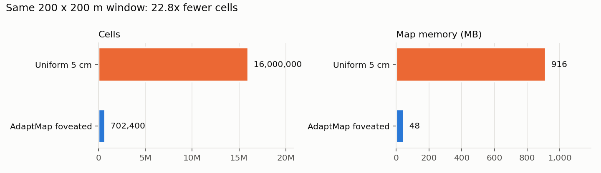
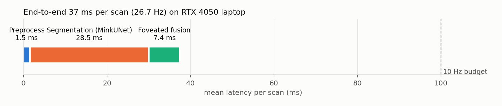
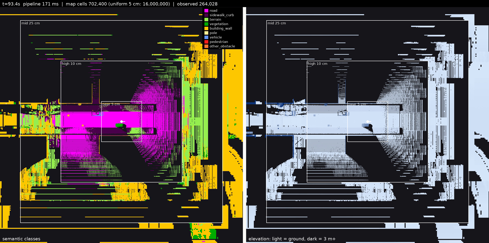
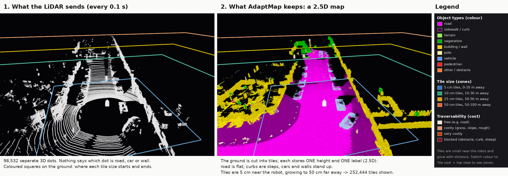

# AdaptMap — Results

All numbers come from the JSON files the evaluation tools write (see `tools/make_results.py`).
Hardware: RTX 4050 Laptop GPU (6 GB), PyTorch 2.1 / CUDA 12.1, ROS 2 Humble, Gazebo Harmonic.

## Map size and speed (offline benchmark)

Simulated 10 Hz drive through the urban world (`tools/benchmark.py`); a uniform 5 cm map is fed the same data.

| | Uniform 5 cm | AdaptMap | Gain |
|---|---|---|---|
| Cells (200 × 200 m) | 16,000,000 | 702,400 | 22.8× |
| Map memory | 916 MB | 48 MB | 19.0× |
| Map update per scan | 40.0 ms | 7.4 ms | 5.4× |

| Stage (per scan) | Mean (ms) |
|---|---|
| Preprocess | 1.5 |
| Segmentation (MinkUNet-34, fp16) | 28.5 |
| Foveated fusion (incl. ray clearing) | 7.4 |
| **Total** | **37.5 (27 Hz)** |

## Speed-adaptive zones

The 5 cm zone follows reaction + braking distance (`adaptive_zones` in the config).

| Speed | 5 cm zone radius | Cells | vs uniform 5 cm | Map update |
|---|---|---|---|---|
| 1 m/s (4 km/h) | 10 m | 702,400 | 22.8× fewer | 7.1 ms |
| 3 m/s (11 km/h) | 10 m | 702,400 | 22.8× fewer | 7.8 ms |
| 5 m/s (18 km/h) | 15.5 m | 870,700 | 18.4× fewer | 8.6 ms |
| 8 m/s (29 km/h) | 25 m | 1,332,400 | 12.0× fewer | 9.6 ms |

## Live ROS 2 + Gazebo

Scripted lap with Gazebo, RViz and the video renderer on the same laptop GPU: **6.0 scans/s** integrated (675 scans, the LiDAR produces ~10/s; the node always takes the newest).

| Stage | Mean (ms) | p95 (ms) |
|---|---|---|
| preprocess | 20.2 | 49.1 |
| segment | 101.5 | 247.9 |
| fuse | 24.0 | 59.1 |
| total | 145.8 | 346.0 |

Publishing runs on its own thread (178 ms per snapshot, 0 dropped). Peak GPU memory 348 MB. Without visualisation the mapping core alone kept up with the sensor at 9.3 scans/s (58 ms/scan).

## Semantic segmentation

### Simulation, held-out world (seed 21)

Fine-tuned on auto-labelled scans from 12 randomised training worlds (`tools/gen_training_data.sh`, `tools/finetune.py`: 10-class AdaptMap head initialised from the KITTI classifier, class-balanced loss, distillation from the pretrained model). The test world was never used for training. All 245 test scans, evaluated with `tools/eval_sim_test.py`.

| Model | road | sidewalk curb | terrain | vegetation | building wall | pole | vehicle | pedestrian | other obstacle | **mIoU** |
|---|---|---|---|---|---|---|---|---|---|---|
| pretrained (KITTI head mapped) | 85 | 75 | 9 | 0 | 81 | 55 | 38 | 60 | 39 | **49.0** |
| fine-tuned v1: 6 worlds | 77 | 98 | 94 | 74 | 88 | 91 | 48 | 64 | 77 | **79.0** |
| fine-tuned v2: 12 worlds + distillation | 96 | 98 | 96 | 72 | 98 | 96 | 93 | 65 | 82 | **88.4** |
| fine-tuned v3: v2 recipe on corrected labels, default | 98 | 98 | 94 | 78 | 98 | 96 | 98 | 65 | 81 | **89.6** |
| fine-tuned v4: mixed sim + SemanticPOSS | 97 | 96 | 87 | 19 | 98 | 95 | 97 | 60 | 80 | **81.0** |

Labels: an earlier version of `tools/fix_labels.py` (the ground-contact repair for the older recordings) relabelled whole car sides next to the robot as road wherever no ground was visible within 1 m, i.e. inside the LiDAR's blind disc. That made v2 look worse on vehicles (46 %) and v1 better; fixed and relabelled 2026-10-14. v1 was trained only on those corrupted worlds and learned the same mistake (vehicle 48 %). v3 retrains the v2 recipe on the corrected labels: +1.2 mIoU here and +0.2 on the demo world, and it labels car sides next to the robot correctly, which v2 did not: in the navigation stress test v2 called 30 % of a parked car's points road from beside it and the robot froze in an empty lane. v3 is the default; v2 is 2 points better on demo-world pedestrians. v4 adds SemanticPOSS sequences 00–04 to the training mix (`--real`); it loses 9 points here, mostly vegetation (19 %), so it is not the sim default.

### Simulation, demo world (second held-out world, recorded lap)

| Model | road | sidewalk curb | terrain | vegetation | building wall | pole | vehicle | pedestrian | other obstacle | **mIoU** |
|---|---|---|---|---|---|---|---|---|---|---|
| pretrained (SemanticKITTI) | 96 | 85 | 6 | 1 | 84 | 35 | 77 | 79 | 0 | **51.4** |
| fine-tuned v1 (6 worlds) | 78 | 98 | 90 | 43 | 87 | 89 | 54 | 84 | 96 | **79.9** |
| fine-tuned v2 (12 worlds + distillation) | 98 | 99 | 91 | 61 | 98 | 90 | 98 | 80 | 97 | **90.2** |
| fine-tuned v3 (v2 recipe, corrected labels, default) | 98 | 99 | 90 | 63 | 98 | 91 | 99 | 78 | 97 | **90.4** |
| fine-tuned v4 (mixed sim + SemanticPOSS) | 99 | 97 | 80 | 41 | 98 | 90 | 98 | 63 | 96 | **84.6** |

### Real data: SemanticPOSS (labelled, 40-beam Pandora, university campus)

SemanticPOSS has one 'ground' class, so road / sidewalk / terrain are merged. Different sensor (40 beams) and scene type (campus) than the KITTI training data; no SemanticPOSS data was used for training.

| Model | ground | vegetation | building wall | pole | vehicle | pedestrian | other obstacle | **mIoU** |
|---|---|---|---|---|---|---|---|---|
| pretrained (SemanticKITTI) | 70 | 66 | 70 | 38 | 54 | 7 | 0 | **43.6** |
| fine-tuned v1 (sim) | 10 | 12 | 0 | 2 | 17 | 1 | 0 | **6.2** |
| fine-tuned v2 (sim) | 2 | 20 | 15 | 18 | 20 | 2 | 0 | **11.0** |
| fine-tuned v2 (sim), constant intensity | 63 | 33 | 48 | 26 | 41 | 53 | 3 | **38.3** |

#### SemanticPOSS held-out sequence 05 (pretrained vs mixed fine-tune v4)

v4 was trained on sim + SemanticPOSS sequences 00–04, so all models are scored here on sequence 05 only (250 scans, every 2nd; `tools/eval_semanticposs.py --seqs 05 --every 2 --out semanticposs_seq05.json`).

| Model | ground | vegetation | building wall | pole | vehicle | pedestrian | other obstacle | **mIoU** |
|---|---|---|---|---|---|---|---|---|
| pretrained (SemanticKITTI) | 83 | 67 | 74 | 37 | 53 | 8 | 0 | **46.0** |
| fine-tuned v3 (sim), constant intensity | 83 | 37 | 60 | 25 | 44 | 52 | 2 | **43.2** |
| fine-tuned v4 (sim + POSS 00-04) | 2 | 27 | 57 | 30 | 18 | 14 | 0 | **21.2** |
| fine-tuned v4 (sim + POSS 00-04), constant intensity | 86 | 60 | 71 | 38 | 57 | 74 | 6 | **56.0** |

With constant intensity v4 is the best model on unseen real data (+10 mIoU over the pretrained model, pedestrians 8 → 74 %). With the sensor's real intensity it fails: it calls ~96 % of ground points vehicle, on the training sequences too. Training only checked real data at constant intensity, so this went unnoticed; the cause is not yet known. Real sensors therefore keep the pretrained model (`model_real`).

## Real data: KITTI raw drive 2011_09_26_drive_0005_sync

154 real HDL-64 scans with GPS/IMU poses through the full pipeline (`tools/run_dataset.py`): preprocess 2.2 ms, segmentation 41.3 ms, fusion 8.6 ms, total **52.1 ms (19.2 Hz)**; 121,708 raw → 121,163 points per scan.

## Autonomous navigation (Nav2 on the AdaptMap costmap)

**14/15 scenario runs passed** (5 scenarios × 3 runs, `tools/nav_scenarios.py --repeat 3`; the rover is teleported to each scenario's start, pedestrian timing differs per run). Pass = expected outcome (reach the goal, or refuse a goal behind a curb), never left the road, no contact with a static obstacle, and no contact with a pedestrian while moving. Clearances are from the rover's footprint outline; the worst run is shown.

| Scenario | Expected | Passed | Time (median) | Distance (median) | Min clearance (static) | Min distance to pedestrians | Rover speed there |
|---|---|---|---|---|---|---|---|
| pedestrian crossing | reach | 3/3 ✅ | 23.7 s | 25.0 m | 1.02 m | 0.53 m | 0.00 m/s |
| around lane car | reach | 3/3 ✅ | 25.8 s | 30.2 m | 0.60 m | – | – |
| sidewalk goal refused | refuse | 2/3 ❌ | 61.0 s | 43.2 m | 0.00 m | – | – |
| long route | reach | 3/3 ✅ | 46.3 s | 54.8 m | 1.31 m | – | – |
| u turn | reach | 3/3 ✅ | 19.5 s | 20.2 m | 0.99 m | – | – |

## Long run (stability)

Nav2 demo suite x3 driving continuously (sim + AdaptMap + Nav2, no visualisation): 11.6 min, 5,329 scans (7.6 scans/s). Pipeline time 131.5 ms/scan in the first quarter, 94.7 ms in the last; GPU peak 379 → 379 MB; process memory 1696 MB after 1 min, 1713 MB after 4 min, 1714 MB at the end. No growth after warm-up: no leak, no slowdown.

## Navigation stress test: five worlds of rising difficulty

`tools/make_tier_worlds.py` builds five test worlds, each with its own scenarios; `tools/run_tier_suite.sh` runs them (`tools/nav_scenarios.py --world tierN`). A *refuse* scenario passes when the robot does not reach a goal that has no safe way to it. Contact counts against the robot's full height including the 1.8 m LiDAR mast, so an overhang below that is a collision.

| Tier | World | Scenarios | Runs passed |
|---|---|---|---|
| 1 | Open road | 5 | 15/15 |
| 2 | Parked street | 5 | 15/15 |
| 3 | Pedestrian zone | 6 | 18/18 |
| 4 | Obstacle course | 8 | 24/24 |
| 5 | Chaos | 6 | 14/18 |

### Tier 1: Open road

| Scenario | What it tests | Expected | Passed | Time (median) | Min clearance (static) | Min distance to pedestrians |
|---|---|---|---|---|---|---|
| straight | 45 m straight on a clear lane | reach | 3/3 ✅ | 37.9 s | 1.16 m (car_0) | – |
| crate in lane | a crate sits on the drive line at x = 25 | reach | 3/3 ✅ | 33.9 s | 0.73 m (crate_line) | – |
| lane change | goal in the opposite lane | reach | 3/3 ✅ | 37.4 s | 1.75 m (car_0) | – |
| u turn | turn around inside the 8 m road | reach | 3/3 ✅ | 19.5 s | 1.71 m (car_1) | – |
| sidewalk goal | goal behind a 15 cm curb | refuse | 3/3 ✅ | 61.0 s | 2.18 m (pole_5_1) | – |

### Tier 2: Parked street

| Scenario | What it tests | Expected | Passed | Time (median) | Min clearance (static) | Min distance to pedestrians |
|---|---|---|---|---|---|---|
| double parked | an SUV double-parked in the right lane at x = 33 | reach | 3/3 ✅ | 22.4 s | 0.58 m (double_parked) | 0.85 m at 0.0 m/s |
| slow crosser | a pedestrian crosses at 0.7 m/s at x = 40 | reach | 3/3 ✅ | 24.0 s | 0.41 m (pl_3) | 0.40 m at 0.0 m/s |
| narrow gap | crates and parked cars leave a single 1.7 m gap | reach | 3/3 ✅ | 17.9 s | 0.36 m (gap_b) | – |
| park between cars | goal in a 6 m gap between parked cars | reach | 3/3 ✅ | 10.1 s | 0.73 m (pr_6) | – |
| long route | 118 m past everything above | reach | 3/3 ✅ | 99.2 s | 0.31 m (gap_b) | 0.81 m at 0.0 m/s |

### Tier 3: Pedestrian zone

| Scenario | What it tests | Expected | Passed | Time (median) | Min clearance (static) | Min distance to pedestrians |
|---|---|---|---|---|---|---|
| two crossers | two people cross in opposite directions at x = 20 and 23 | reach | 3/3 ✅ | 37.4 s | 2.21 m (pole_3_-1) | -0.34 m at 0.0 m/s |
| head on | a person walks down the rover's lane, towards it half the time | reach | 3/3 ✅ | 38.1 s | 2.58 m (pole_6_-1) | 0.25 m at 0.0 m/s |
| walker ahead | a person walks ahead in the left lane at 0.8 m/s | reach | 3/3 ✅ | 40.9 s | 2.50 m (pole_6_1) | 0.71 m at 0.0 m/s |
| runner | a runner crosses at 2 m/s at x = 125 | reach | 3/3 ✅ | 33.3 s | 2.09 m (pole_9_-1) | -0.11 m at 0.0 m/s |
| stops in lane | a person crosses at x = 145 and stands 6 s in the lane | reach | 3/3 ✅ | 30.0 s | 2.59 m (pole_10_-1) | -0.17 m at 0.0 m/s |
| diagonal | a person crosses diagonally (x 160 -> 172) | reach | 3/3 ✅ | 28.2 s | 2.98 m (pole_11_-1) | – |

### Tier 4: Obstacle course

| Scenario | What it tests | Expected | Passed | Time (median) | Min clearance (static) | Min distance to pedestrians |
|---|---|---|---|---|---|---|
| narrow passage | a wall across the road with a 1.4 m opening | reach | 3/3 ✅ | 25.4 s | 0.26 m (passage_r) | – |
| gap too narrow | a wall across the road with only a 0.55 m gap | refuse | 3/3 ✅ | 61.0 s | 0.12 m (passage_r) | – |
| low box | a 20 cm box on the drive line (lost from view up close) | reach | 3/3 ✅ | 22.3 s | 0.85 m (low_box) | – |
| thin pole | a 4 cm thin pole on the drive line | reach | 3/3 ✅ | 20.5 s | 0.38 m (thin_pole) | – |
| speed bump | a 6 cm bump across the road: drive over it | reach | 3/3 ✅ | 48.2 s | 2.57 m (pole_9_-1) | – |
| curb wall | a 15 cm wall across the whole road: cannot climb | refuse | 3/3 ✅ | 61.0 s | 2.58 m (pole_10_1) | – |
| overhang high | a bar across the road 2.2 m up: drive under | reach | 3/3 ✅ | 22.0 s | 2.94 m (pole_12_-1) | – |
| overhang low | a bar 1.3 m up: the 1.8 m LiDAR mast would hit it | refuse | 3/3 ✅ | 41.7 s | 3.48 m (pole_13_-1) | – |

### Tier 5: Chaos

| Scenario | What it tests | Expected | Passed | Time (median) | Min clearance (static) | Min distance to pedestrians |
|---|---|---|---|---|---|---|
| occluded walker | a person steps out from behind a parked car at x = 26.5 | reach | 3/3 ✅ | 30.7 s | 0.54 m (pr_3) | 0.16 m at 0.0 m/s |
| chicane | crates force an S-bend at x = 40 and 47 | reach | 3/3 ✅ | 19.6 s | 0.32 m (chicane_b) | – |
| group crossing | three people cross together at x = 59-62 | reach | 0/3 ❌ | 91.0 s | 0.89 m (pr_6) | -0.35 m at 0.0 m/s |
| head on narrow | a person walks down the single lane; a 25 cm crate at x = 75 | reach | 3/3 ✅ | 38.6 s | 0.41 m (pl_7) | -0.35 m at 0.0 m/s |
| stopper | a person stops 5 s in the lane at x = 108 | reach | 3/3 ✅ | 22.9 s | 0.49 m (pl_9) | 0.63 m at 0.0 m/s |
| full run | 125 m through all of the above | reach | 2/3 ❌ | 217.7 s | 0.17 m (pl_9) | -0.35 m at 0.0 m/s |

## Second robot: a larger UGV (no retraining)

The same model, map and costmaps on a 4-wheel skid-steer UGV, 1.40 × 0.95 m, LiDAR 1.30 m up and 0.35 m forward (`robot:=ugv`, profile `configs/robots/ugv.yaml`: extrinsics, self-filter box, footprint, height). The segmentation model was trained at the rover's 1.73 m sensor height; scans are shifted to that height before segmentation only.

| World | Scenario | Expected | Passed | Min clearance (static) |
|---|---|---|---|---|
| Demo world | pedestrian crossing | reach | 1/1 ✅ | 0.80 m |
| Demo world | around lane car | reach | 1/1 ✅ | 0.69 m |
| Demo world | sidewalk goal refused | refuse | 1/1 ✅ | 0.26 m |
| Demo world | long route | reach | 1/1 ✅ | 1.16 m |
| Demo world | u turn | reach | 1/1 ✅ | 0.76 m |
| Tier 1 | straight | reach | 1/1 ✅ | 1.02 m |
| Tier 1 | crate in lane | reach | 1/1 ✅ | 0.62 m |
| Tier 1 | lane change | reach | 1/1 ✅ | 1.85 m |
| Tier 1 | u turn | reach | 1/1 ✅ | 1.53 m |
| Tier 1 | sidewalk goal | refuse | 1/1 ✅ | 1.84 m |
| Tier 4 | narrow passage | reach | 0/1 ❌ | 0.45 m |
| Tier 4 | gap too narrow | refuse | 1/1 ✅ | 0.83 m |
| Tier 4 | low box | reach | 1/1 ✅ | 0.71 m |
| Tier 4 | thin pole | reach | 1/1 ✅ | 0.91 m |
| Tier 4 | speed bump | reach | 1/1 ✅ | 3.33 m |
| Tier 4 | curb wall | refuse | 1/1 ✅ | 3.23 m |
| Tier 4 | overhang high | reach | 1/1 ✅ | 2.93 m |
| Tier 4 | overhang low | refuse | 1/1 ✅ | 2.96 m |
