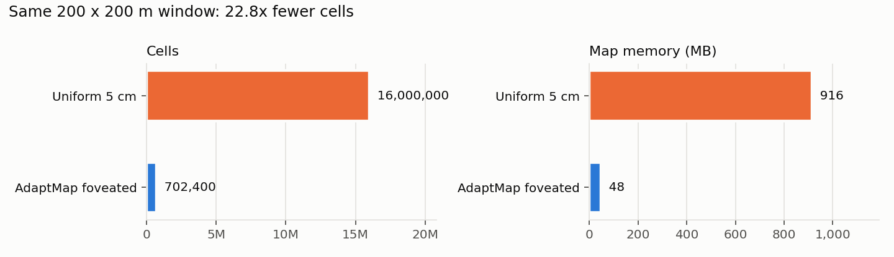
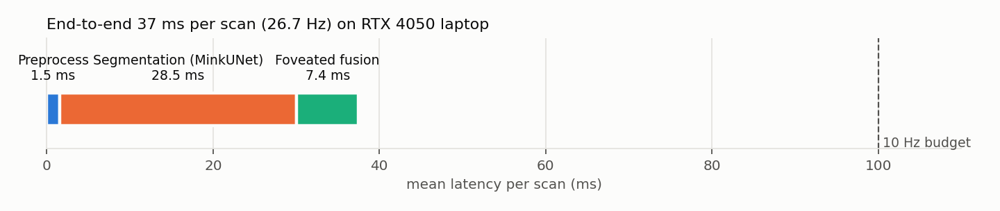
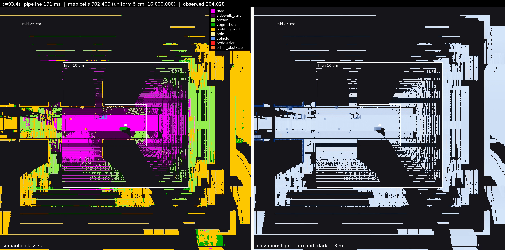
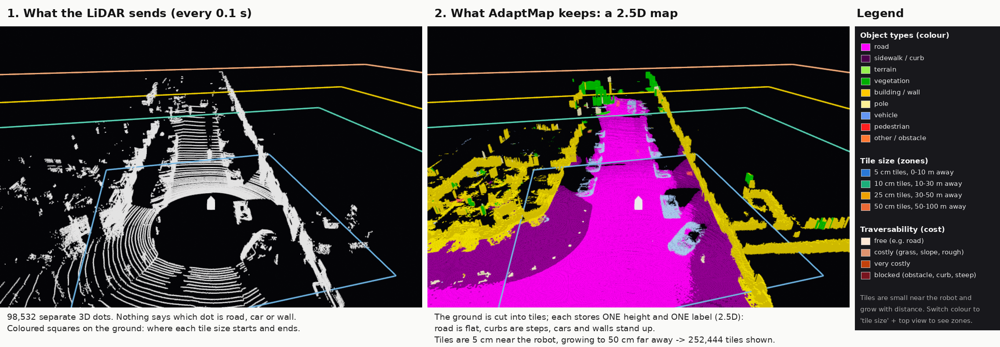

# AdaptMap — Results

All numbers come from the JSON files the evaluation tools write (see `tools/make_results.py`).
Hardware: RTX 4050 Laptop GPU (6 GB), PyTorch 2.1 / CUDA 12.1, ROS 2 Humble, Gazebo Harmonic.

## Map size and speed (offline benchmark)

Simulated 10 Hz drive through the urban world (`tools/benchmark.py`); a uniform 5 cm map is fed the same data.

| | Uniform 5 cm | AdaptMap | Gain |
|---|---|---|---|
| Cells (200 × 200 m) | 16,000,000 | 702,400 | 22.8× |
| Map memory | 916 MB | 48 MB | 19.0× |
| Map update per scan | 40.0 ms | 7.4 ms | 5.4× |

| Stage (per scan) | Mean (ms) |
|---|---|
| Preprocess | 1.5 |
| Segmentation (MinkUNet-34, fp16) | 28.5 |
| Foveated fusion (incl. ray clearing) | 7.4 |
| **Total** | **37.5 (27 Hz)** |

## Speed-adaptive zones

The 5 cm zone follows reaction + braking distance (`adaptive_zones` in the config).

| Speed | 5 cm zone radius | Cells | vs uniform 5 cm | Map update |
|---|---|---|---|---|
| 1 m/s (4 km/h) | 10 m | 702,400 | 22.8× fewer | 7.1 ms |
| 3 m/s (11 km/h) | 10 m | 702,400 | 22.8× fewer | 7.8 ms |
| 5 m/s (18 km/h) | 15.5 m | 870,700 | 18.4× fewer | 8.6 ms |
| 8 m/s (29 km/h) | 25 m | 1,332,400 | 12.0× fewer | 9.6 ms |

## Live ROS 2 + Gazebo

Scripted lap with Gazebo, RViz and the video renderer on the same laptop GPU: **6.0 scans/s** integrated (675 scans, the LiDAR produces ~10/s; the node always takes the newest).

| Stage | Mean (ms) | p95 (ms) |
|---|---|---|
| preprocess | 20.2 | 49.1 |
| segment | 101.5 | 247.9 |
| fuse | 24.0 | 59.1 |
| total | 145.8 | 346.0 |

Publishing runs on its own thread (178 ms per snapshot, 0 dropped). Peak GPU memory 348 MB. Without visualisation the mapping core alone kept up with the sensor at 9.3 scans/s (58 ms/scan).

## Semantic segmentation

### Simulation, held-out world (seed 21)

Fine-tuned on auto-labelled scans from 12 randomised training worlds (`tools/gen_training_data.sh`, `tools/finetune.py`: 10-class AdaptMap head initialised from the KITTI classifier, class-balanced loss, distillation from the pretrained model). The test world was never used for training.

| Model | road | sidewalk curb | terrain | vegetation | building wall | pole | vehicle | pedestrian | other obstacle | **mIoU** |
|---|---|---|---|---|---|---|---|---|---|---|
| pretrained (KITTI head mapped) | 68 | 74 | 9 | 0 | 73 | 57 | 34 | 60 | 44 | **46.6** |
| fine-tuned v1: 6 worlds (iter 9000) | 94 | 98 | 94 | 39 | 96 | 92 | 81 | 62 | 75 | **81.1** |
| fine-tuned v2: 12 worlds + distillation, default (iter 7500) | 77 | 98 | 95 | 34 | 89 | 86 | 46 | 63 | 75 | **73.8** |

v1 scores higher on this world but fails on the demo world's pickup truck (its flat bed is called road); averaged over both held-out worlds v2 is better, so it is the default.

### Simulation, demo world (second held-out world, recorded lap)

| Model | road | sidewalk curb | terrain | vegetation | building wall | pole | vehicle | pedestrian | other obstacle | **mIoU** |
|---|---|---|---|---|---|---|---|---|---|---|
| pretrained (SemanticKITTI) | 96 | 85 | 6 | 1 | 84 | 35 | 77 | 79 | 0 | **51.4** |
| fine-tuned v1 (6 worlds) | 78 | 98 | 90 | 43 | 87 | 89 | 54 | 84 | 96 | **79.9** |
| fine-tuned v2 (12 worlds + distillation, default) | 98 | 99 | 91 | 61 | 98 | 90 | 98 | 80 | 97 | **90.2** |

### Real data: SemanticPOSS (labelled, 40-beam Pandora, university campus)

SemanticPOSS has one 'ground' class, so road / sidewalk / terrain are merged. Different sensor (40 beams) and scene type (campus) than the KITTI training data; no SemanticPOSS data was used for training.

| Model | ground | vegetation | building wall | pole | vehicle | pedestrian | other obstacle | **mIoU** |
|---|---|---|---|---|---|---|---|---|
| pretrained (SemanticKITTI) | 70 | 66 | 70 | 38 | 54 | 7 | 0 | **43.6** |
| fine-tuned v1 (sim) | 10 | 12 | 0 | 2 | 17 | 1 | 0 | **6.2** |
| fine-tuned v2 (sim) | 2 | 20 | 15 | 18 | 20 | 2 | 0 | **11.0** |
| fine-tuned v2 (sim), constant intensity | 63 | 33 | 48 | 26 | 41 | 53 | 3 | **38.3** |

## Real data: KITTI raw drive 2011_09_26_drive_0005_sync

154 real HDL-64 scans with GPS/IMU poses through the full pipeline (`tools/run_dataset.py`): preprocess 2.2 ms, segmentation 41.3 ms, fusion 8.6 ms, total **52.1 ms (19.2 Hz)**; 121,708 raw → 121,163 points per scan.

