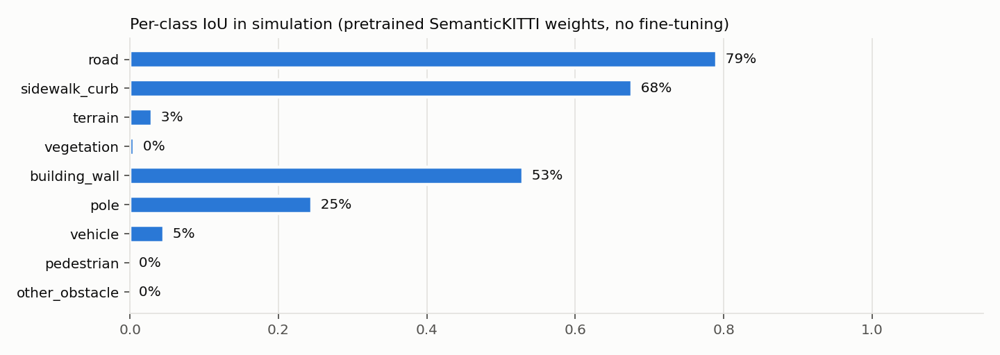
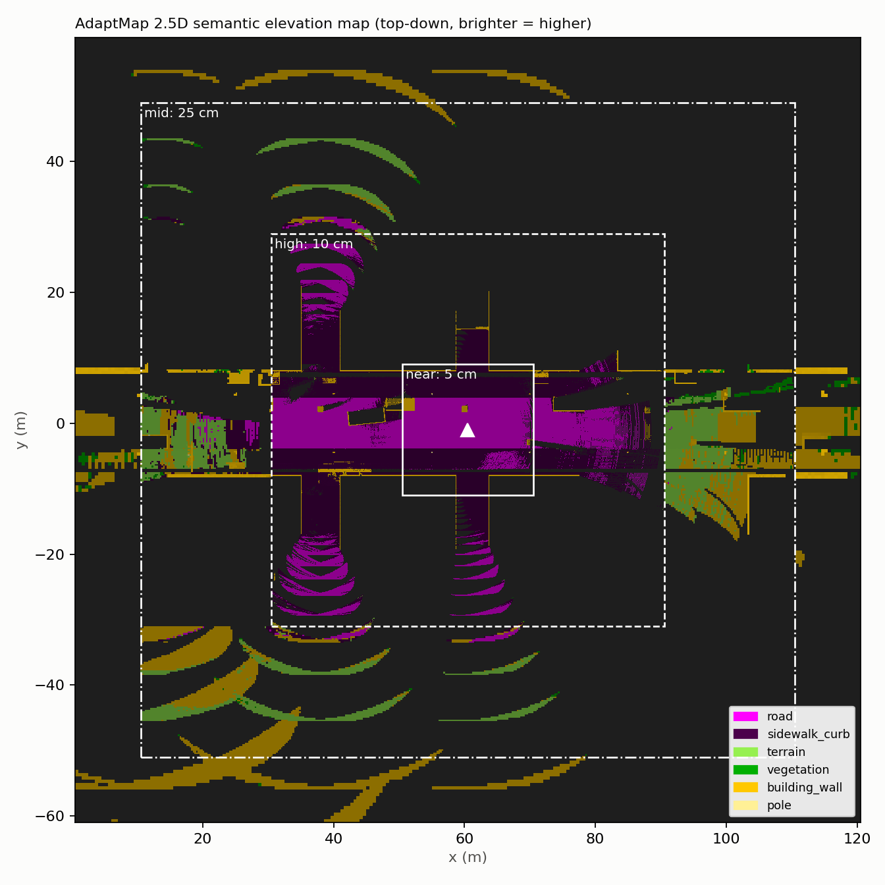

# AdaptMap — Results

Offline benchmark (`python tools/benchmark.py --frames 300`): simulated 10 Hz drive at 2.0 m/s through the urban test world, 64-beam KITTI-like LiDAR at 1.75 m, moving pedestrians. Hardware: RTX 4050 Laptop (6 GB), PyTorch 2.1 / CUDA 12.1.

## Map size: foveated vs uniform

| | Uniform 5 cm | AdaptMap foveated | Reduction |
|---|---|---|---|
| Cells (200 x 200 m window) | 16,000,000 | 702,400 | 22.8x |
| Map memory | 671 MB | 35 MB | 19.0x |
| Occupied cells at end of run | 1,041,784 | 216,634 | 4.8x |
| Fusion time per scan (mean / p95) | 22.4 / 33.9 ms | 3.7 / 5.3 ms | 6.1x |

Per-zone layout:

| Zone | Extent (Chebyshev) | Cell | Cells |
|---|---|---|---|
| near | 0–10 m | 5 cm | 160,000 |
| high | 10–30 m | 10 cm | 320,000 |
| mid | 30–50 m | 25 cm | 102,400 |
| far | 50–100 m | 50 cm | 120,000 |

## Latency

| Stage | Mean (ms) | p95 (ms) |
|---|---|---|
| Preprocess | 1.6 | 2.0 |
| Segmentation (MinkUNet-34, spconv) | 69.8 | 78.7 |
| Foveated fusion | 3.7 | 5.3 |
| **End-to-end** | **75.1** (13.3 Hz) | |

Mean points per scan: 129,177 raw → 129,128 after preprocessing. Peak GPU memory (model + both maps): 1,854 MB.

## Segmentation accuracy (simulation)

Pretrained SemanticKITTI MinkUNet-34 (69.3 mIoU on real SemanticKITTI val, per mmdet3d model zoo), applied zero-shot to simulated scans. Point accuracy **69.1%**, mIoU **25.8%** over classes present.

| Class | IoU |
|---|---|
| road | 79.1% |
| sidewalk_curb | 67.6% |
| terrain | 3.0% |
| vegetation | 0.5% |
| building_wall | 53.0% |
| pole | 24.5% |
| vehicle | 4.5% |
| pedestrian | 0.0% |
| other_obstacle | 0.0% |

Known sim-to-real gap: the analytic ray-caster models cars/pedestrians/crates as plain boxes, which the real-data model reads as walls; the Gazebo world uses real car and walking-person meshes. Closing the gap is what `tools/autolabel.py` + `tools/finetune.py` are for (phase P8).

## Map snapshot

## Segmentation accuracy on Gazebo scans

131 scans from a recorded demo lap (`tools/eval_bag.py`), every 3rd scan. Gazebo renders real car and walking-person meshes; ground truth comes from the world manifest (`tools/autolabel.py`). Pretrained SemanticKITTI weights, zero-shot. Point accuracy **89.2%**, mIoU **44.5%**.

| Class | IoU | GT points | Most confused with |
|---|---|---|---|
| road | 93.2% | 4,941,608 | sidewalk_curb |
| sidewalk_curb | 84.4% | 3,698,884 | road |
| terrain | 7.0% | 675,905 | sidewalk_curb |
| vegetation | 0.5% | 15,353 | building_wall |
| building_wall | 87.1% | 4,929,014 | sidewalk_curb |
| pole | 34.9% | 292,458 | building_wall |
| vehicle | 70.9% | 1,875,277 | building_wall |
| pedestrian | 22.5% | 18,486 | sidewalk_curb |
| other_obstacle | 0.0% | 243,520 | building_wall |

## Live ROS 2 + Gazebo run

Scripted lap through the Gazebo world (`tools/capture_demo.sh`): Gazebo, RViz, the video renderer and AdaptMap all on one RTX 4050 laptop. 592 scans processed over 110 s of sim time (**5.4 scans/s**; the node always takes the newest scan, LiDAR runs at ~8.5 Hz).

| Stage | Mean (ms) | p95 (ms) |
|---|---|---|
| Preprocess | 13.1 | 31.6 |
| Segmentation | 122.4 | 172.7 |
| Foveated fusion | 8.3 | 15.8 |
| **Pipeline total** | 143.8 | 211.7 |
| ROS publishing (every 3rd scan) | 95.3 | 197.1 |

Peak GPU memory 445 MB. Points per scan after preprocessing 127,038. Observed map cells at end of lap 256,126 (of 702,400 foveated cells; a uniform 5 cm map would hold 16,000,000).

Segmentation is slower live than offline (75 ms) because the GPU is shared with Gazebo's LiDAR rendering and the GUIs.

Demo video: [figures/demo.mp4](figures/demo.mp4) — left: semantic classes per zone, right: elevation.

