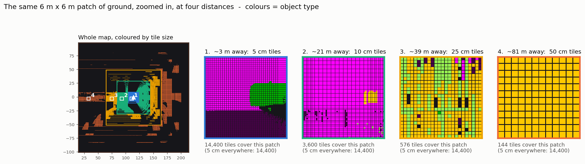

# Testing AdaptMap yourself

This guide is written for someone who isn't a LiDAR specialist.

## The idea in one minute

A **LiDAR** is a spinning laser on the robot. About 10 times per second it measures the distance
to everything around it and reports roughly **130,000 separate dots in 3D space**. The dots carry no
meaning: nothing says "this dot is road, that dot is a car".

**AdaptMap** turns those dots into a map the robot can actually use:

1. **It recognises what each dot is.** A neural network labels every dot: road, sidewalk/curb,
   grass, building/wall, pole, vehicle, pedestrian and so on.
2. **It cuts the ground into square tiles.** For each tile it remembers just **one height** (the top
   of whatever is standing there) and **one label**.
   - That is what **"2.5D"** means: more than a flat 2D map (it knows heights), but less than full 3D
     (it stores one height per tile, not every detail of a shape).
   - Road comes out as flat tiles, a curb as a 15 cm step, and a car or wall as a raised block.
3. **Tiles get bigger with distance.**
   - They are 5 cm wide within 10 m of the robot, 10 cm up to 30 m, 25 cm up to 50 m and 50 cm up to
     100 m.
   - Near the robot, where it might bump into things, the map is sharp. Far away, where the laser
     dots are sparse anyway, it's coarse.
   - This is the "foveated" part, like how your eyes see sharply only where you look.

## What you need

- Everything is installed already (ROS 2, Gazebo, the model).
- **Two terminal windows**: one runs the simulator and the viewer, the other is your steering wheel.

## Step by step

**Terminal 1: start the simulator and the 3D viewer**
```bash
cd ~/Projects/Project_Focal
bash tools/manual_test.sh
```
After about 20–30 s, three windows open:
- **Gazebo**: the simulated city, with the yellow robot on the road.
- **RViz**: the engineering view. You can ignore it.
- **"AdaptMap – how the robot sees the world"**: the 3D viewer to watch.

**Terminal 2: drive the robot**
```bash
source /opt/ros/humble/setup.bash
ros2 run teleop_twist_keyboard teleop_twist_keyboard
```
Keep this terminal focused while you drive.

| Key | Action |
|---|---|
| `i` | forward |
| `,` | backward |
| `j` / `l` | turn left / right |
| `k` | stop |
| `q` / `z` | faster / slower |

The default speed of 0.5 m/s is gentle. Press `q` a few times to go faster.

**In the 3D viewer**, use the panel on the right:

| Control | What it does |
|---|---|
| **Show** | the 2.5D map, the raw LiDAR dots, or both overlaid |
| **Colour tiles by** | *Object type* (road, car, wall, …) or *Tile size*, which colours each tile by its zone so the variable resolution becomes visible |
| **Camera: Chase / Top-down** | behind the robot, or straight down over the whole 200 m map |
| **Follow robot** | untick to orbit freely: drag = rotate, scroll = zoom, shift+drag = pan |
| **Show zone outlines + labels** | coloured squares on the ground marking where each tile size starts, e.g. "5 cm tiles (0-10 m)" |
| **Legend** | what every colour means |

Close the window to quit; that also shuts the simulator down. The view refreshes about once a
second, so it isn't a smooth video feed.

## Record a video while you drive

Instead of opening a window, record a side-by-side explainer: raw dots on the left, the 2.5D map on
the right, with captions.

```bash
bash tools/manual_test.sh --video data/my_drive.mp4                  # coloured by object type
bash tools/manual_test.sh --video data/my_zones.mp4 --color zone --top  # top-down, coloured by tile size
```
Drive in terminal 2, then press **Ctrl-C** in terminal 1 to stop. The video is written on exit, along
with a still image of the last frame (`data/my_drive.png`). A pre-recorded example from a scripted lap
is in `docs/figures/explainer_25d.mp4`.

## How the variable resolution works (and why it's hard to see)



The figure shows **the same 6 m × 6 m patch of ground at four distances**, zoomed so every tile is
visible:

| Distance | Tile size | Tiles covering that 6 × 6 m patch |
|---|---|---|
| 0–10 m | 5 cm | 14,400 |
| 10–30 m | 10 cm | 3,600 |
| 30–50 m | 25 cm | 576 |
| 50–100 m | 50 cm | 144 |

So the same ground is stored with up to 100× fewer tiles when it's far away.
To regenerate the figure from your own drive, run `tools/resolution_figure.py` while the sim is up.

**Why the 3D view seems to have "equal detail" near and far:**

1. **Perspective hides it, on purpose.** A 50 cm tile 80 m away covers about as many pixels on screen
   as a 5 cm tile 8 m away. The tile sizes follow how the LiDAR's detail falls off with distance, so
   from the robot's point of view every tile looks roughly the same size. That's the design working.
   To see the difference, choose **Colour tiles by: Tile size** and the **Top-down** camera, or look
   at the zoom figure.
2. **Tiles in one colour merge together.** A road made of 50 cm tiles looks the same as one made of
   5 cm tiles unless you can see the tile edges. In tile-size colouring the viewer leaves small gaps
   between tiles, so the grid shows.
3. **The far-away stripes are the laser, not the tiles.** The LiDAR's 64 beams hit the ground in
   rings. Those rings spread apart fast: about 0.4 m apart at 10 m, 1.6 m at 20 m, 3.6 m at 30 m.
   Tiles between two rings get no dots, so they stay empty. That is why distant ground looks striped
   in both the raw view and the map. The gap is much bigger than any tile, so smaller tiles out
   there would only mean more empty tiles, not more detail. That is exactly why AdaptMap uses bigger
   tiles far away.

**Why the robot benefits:**
- Near the robot, where it might hit something, the map is as sharp as the sensor allows.
- Far away, where the sensor only gives a sparse sample, the map spends 100× less memory and work on
  the same area.
- Overall the map holds 702,400 tiles instead of the 16,000,000 a uniform 5 cm map would need.

## How to tell it's really 2.5D

Switch between `1` and `2` in the viewer while looking at these:

| Look at | Raw LiDAR (key 1) | AdaptMap (key 2) |
|---|---|---|
| Road | rings of dots | flat pink tiles |
| Sidewalk | dots, same as the road | dark purple tiles **raised 15 cm**: the curb step is visible |
| Building | a wall of dots | a yellow block standing up |
| Parked car | a dot-shaped car silhouette | a blue block as tall as the car |
| Pole / lamp post | a thin line of dots | a thin tall column |
| Tree | trunk + crown of dots | a **solid column down to the ground**. A 2.5D map stores only the top height, so it can't represent the gap under the crown. This is the "0.5D" limit |

Things to try:
- **Tile size:** drive close to a parked car and zoom in. The tiles under the robot are tiny (5 cm).
  Look far down the road and they're big (50 cm).
- **Moving pedestrians:** walk past them, or let one cross in front of you (one crosses the road at
  x ≈ 18 m). Their block follows them and fades behind them within about a second instead of leaving
  a trail.
- **Grass slope:** there is a tilted ramp behind the buildings on the right (x ≈ 25 m, y ≈ −20 m).
  Stop on the road at x ≈ 37 m, where there is a gap between the buildings, and look through it in
  the viewer. The ramp shows as tiles that rise steadily instead of jumping in a block. The rover
  can't climb the 15 cm curb, so look rather than drive there.

## Let the robot drive itself (Nav2)

Once, install Nav2 (needs your password): `sudo bash scripts/install_nav2.sh`.

```bash
cd ~/Projects/Project_Focal
source /opt/ros/humble/setup.bash && source ros2_ws/install/setup.bash
ros2 launch adaptmap_nav nav.launch.py
```

When RViz is up, click **2D Goal Pose** in the toolbar, then click-and-drag on the road where you
want the robot to go. You'll see:

- **cyan line**: the planned route (global plan), recomputed as the map changes;
- **yellow line**: what the controller is following right now;
- the robot keeping to the road. Curbs are "blocked" in the costmap, so it never climbs onto the
  sidewalk;
- it steering around parked cars and crates, and slowing near obstacles.

A goal *on* the sidewalk can't be reached: there's no way up the curb, and Nav2 reports failure
instead of driving onto it.

To see what the planner sees, run the 3D viewer at the same time (`.venv/bin/python
tools/view25d.py`) and choose **Colour tiles by: Traversability**:

| Colour | Meaning |
|---|---|
| pale | free road |
| darker orange | more costly (sidewalk, grass, slopes, rough ground) |
| dark red | blocked (walls, cars, curbs, steep slopes) |

Automatic check of five scenarios (pedestrian crossing, passing the lane car, refusing a sidewalk
goal, a long route, a U-turn), with pass/fail and safety distances:
`.venv/bin/python tools/nav_scenarios.py` (while nav is running).

## Known mistakes you will see

The default network is fine-tuned on auto-labelled scans from 12 simulated worlds
(`tools/finetune.py`, model v2). It is much better than the original real-data network on this
simulator (90 vs 51 mIoU on the demo world, 88 vs 49 on test world 21), but some mistakes remain:
- **Vegetation** is the weakest class (61–72 % IoU depending on the world).
- **Pedestrians** are partly missed in the less familiar test world (65 % IoU there, 80 % on the demo
  world). The navigation still keeps clear of people, because anything tall in the way is an obstacle
  whatever its label; the label only adds the pedestrian keep-out and the walking prediction.

These are labelling errors, not mapping errors: the heights are still right.

## Does it make the robot faster? (honest answer)

Measured on this laptop (RTX 4050), per LiDAR scan (offline benchmark, `docs/RESULTS.md`):

| Stage | Plain uniform 5 cm map | AdaptMap |
|---|---|---|
| Cleaning up the dots | 1.5 ms | 1.5 ms |
| Recognising the dots (neural network, half precision) | 28.5 ms | 28.5 ms (unchanged) |
| Building the map | 40.0 ms | **7.4 ms (5.4× faster)** |
| Map memory | 916 MB | **48 MB (19× smaller)** |
| Tiles a path planner has to look at | 16,000,000 | **702,400 (23× fewer)** |
| **Total per scan** | ~70 ms (14 Hz) | **37.5 ms (27 Hz, ~1.9× faster)** |

What this means:
- **The map side gets much cheaper.**
  - Mapping is 5.4× faster and memory is 19× smaller. On a robot computer such as a Jetson
    (4–8 GB of memory shared by everything), 916 MB just for the map is a real problem; 48 MB isn't.
  - Anything that reads the map (path planning, obstacle checks, sending the map over Wi-Fi to an
    operator or another robot) has 23× less to process.
- **End-to-end, a scan gets about 1.9× faster, not 20×.** Once the network runs in half precision,
  a uniform 5 cm map becomes the slowest part, and that is the part AdaptMap shrinks. The network
  itself is unchanged.
  - We tested thinning out distant dots before the network: it cut the dots by 15 % but the network
    time by only 2.5 %. The network works on 5 cm blocks, and most dots are close to the robot.
  - Making the network faster still is a separate job: TensorRT on the robot computer, or a
    lighter network.
- **In the live simulator the pipeline runs at about 6 scans per second**, because the same GPU is
  also running Gazebo's laser simulation and the 3D windows (the network alone then takes ~100 ms
  instead of 28.5 ms). Without the 3D windows the mapping keeps up with the sensor at 9.3 scans per
  second. On a real robot there is no simulator competing for the GPU.

## If something goes wrong

- **"AdaptMap produced no output"**: check `data/manual_*/launch.log`. Gazebo may need a few more
  seconds on a cold start, so just run it again.
- **The robot doesn't move**: the teleop terminal must be focused when you press keys.
- **Leftover windows or processes**: run `bash tools/stop_demo.sh`.
